# Tessera Studio Guide

Tessera Studio is a schematic editor, simulator, waveform viewer and prover for Tessera designs. A drawing is Tessera Java. Every part becomes a line of the builder API you could have typed, and every wire becomes a named value. The file you save is a `.java` file that compiles with the rest of your project. The design runs while you draw. The canvas, the waves, the board and the inspector all show the same cycle, and any of them can move you to another one.

This guide is a reference, ordered by task. Pictures are taken by the Studio's own browser tests (`tessera-eval/browser/guideshots.mjs`), so they show the tool as it is.

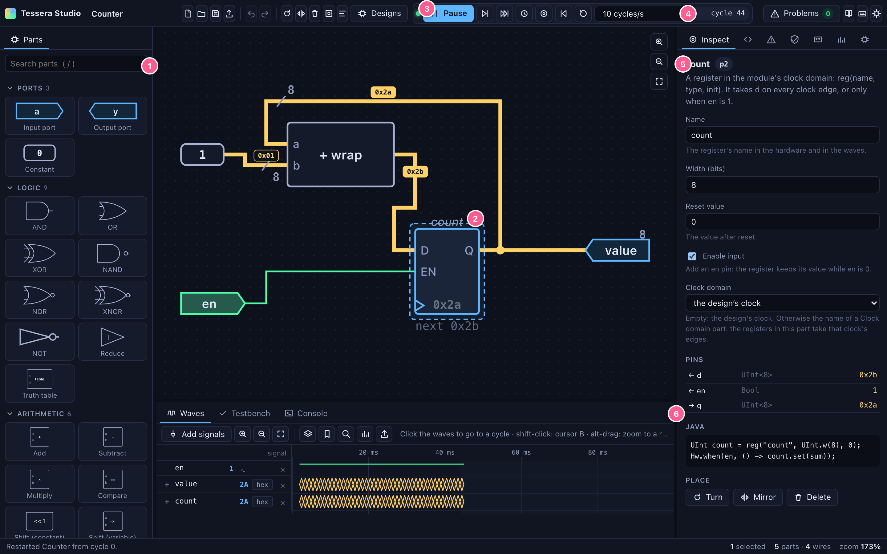

In the picture: **1** the palette, searched with `/`; **2** a selected register on the canvas, showing its value and the next one; **3** run and pause; **4** the cycle shown; **5** the inspector for the selection; **6** the dock with the waves, the testbench and the console.

---

## 1. Starting

**Run it.** From the repository root:

```
./gradlew :tessera-studio:installDist
tessera-studio/build/install/tessera-studio/bin/tessera-studio [options]
```

Then open the address it prints (`http://127.0.0.1:8800/` by default). The server listens on 127.0.0.1 only.

| Option | Meaning |
|---|---|
| `--port N` | The port (default 8800). |
| `--src DIR[:DIR…]` | Your project's Java sources. Their `Module` classes appear in the palette (*Modules → This project*). Drawings may use them, and drawings are compiled with them. |
| `--designs CLASS` | A registry of designs to open from *Designs*: a class with a static method `studioDesigns()` returning a `Map<String, Supplier<? extends Module>>`. The RISC-V cores of `tessera-riscv` and their variants are always listed. |
| `--hz N` | The clock frequency the simulator assumes for `Clock`-based parts such as Blink (default 1000). |
| `--dev DIR` | Serve the front end from `DIR` file by file, so edits to the web sources show on reload. |

**The screen.**
- *Toolbar*, left to right: new, open, save, *Designs*, export, undo and redo, turn, mirror, delete, make block, tidy. Then the run bar: run or pause, one cycle, ten cycles, run until, back, reset, rate and the cycle pill. Then the problems badge, shortcuts and theme.
- *Left:* the palette. In the explorer it shows the design's signals instead.
- *Centre:* the canvas, with the waves and the console in a dock beneath it.
- *Right:* Inspect, Java, Problems, Prove, Board and Analyse. A narrow panel shows icons, plus the open tab's label.
- *Status line:* the last message, what the pointer is over, the selection, the size of the drawing and the zoom.

The drawing is kept in the browser between visits. Save it as `.java` to keep it anywhere else.

**Narrow screens.** Below 900 px the side panels become drawers, opened from the buttons at the two ends of the toolbar, and the canvas takes the width. On a phone (below 600 px) the toolbar keeps viewing and running: the run bar, *Designs*, problems and the drawers. Editing is meant for a desktop; ⌘K still reaches every command.

---

## 2. Drawing

### Parts
- **Placing:** drag a card from the palette onto the canvas, or click a card to place it at the centre. Press `/` (or double-click empty canvas) to search for a part by name and place it there.
- **Selecting:** click to select; shift-click to add; drag on empty canvas for a marquee.
- **Moving:** drag a part, or nudge with the arrows (Shift: by 10 grid steps).
- **Turning and mirroring:** R turns a quarter clockwise (Shift+R anticlockwise); M mirrors. Text stays upright.
- **Editing:** the inspector (right) edits the selected part's parameters. Fields check what you type and say what is wrong before anything changes. Every change is one undo step.
- **Copy and paste:** ⌘C, ⌘X, ⌘V and ⌘D duplicate within a drawing, wires between copied parts included.

### Wires
- **Drawing:** press on a pin and drag to another pin. The ghost shows the route the router will take.
- **Branching:** drag from the middle of an existing wire to tap it; a junction dot appears where it branches.
- **Dropping:** let go on empty canvas to add a part there, connected to the wire you dragged.
- **Routing:** wires are routed on the grid, never along another wire and never through a part, with bends and crossings kept few. When some wires cannot be routed, the router tries again with those first (up to three passes). A wire that still cannot be routed is drawn dashed, and the problems list says so.
- **Manual bends:**
  - Alt-drag a wire between two pins to make it pass through a point. Alt-drag the bend's diamond to move it; Alt-click it to remove it.
  - Bends are kept until *Tidy* lays that part of the drawing out again.
- **Hover:** hovering a wire or pin lights the whole net, every branch and every pin it joins, and dims the rest.
- **Names:** a wire's name becomes the Java variable for its value, and the name you see in the waves. Double-click a wire (or select it and press L) to name it.
- **Widths:** a bus is drawn thicker, with its width beside a slash.

### Keyboard wiring
- Select a part, press **Tab** to step through its pins (Shift+Tab backwards), and **Enter** to start a wire.
- The **arrows** go to the nearest pin in that direction, across the whole drawing; **Enter** connects. **Escape** cancels the wire, then the pin focus.
- Every step is announced to screen readers, e.g. "Register count, pin q (output, 8 bits, wired)".

### Hierarchy: blocks
- **Make a block:** select parts and press **B**, then name the block (a Java class name). Wires that cross the selection's edge become the block's ports, named after what drives them. The selection is replaced by one use of the block.
- **Open a block:** double-click it. The breadcrumb at the top left shows where you are; **Escape** (with nothing selected) or a click on the breadcrumb goes back up.
- **Editing inside:**
  - Every use of a block follows its definition. Adding a port to a block adds the pin everywhere; removing one drops the wires to it.
  - The values shown inside a block are those of the use you opened (`u1`, or `u1.u2` deeper).
- **Reuse:** blocks appear under *My blocks* in the palette.
- **In the Java:** each block is a `public static class … extends Module` nested in the design's class, and each use is `instance("u1", () -> new Inc())`.

### Arranging
- **Tidy** (toolbar) lays the whole drawing out again, or only the selection when several parts are selected:
  - inputs at the left, outputs at the right;
  - registers in columns by pipeline position;
  - long rows wrapped into columns.
- **F** fits the drawing to the window; Shift+F fits the selection. Ctrl+wheel or `+`/`−` zoom; hold Space and drag to pan.

### Parts in the palette
The full list, with parameters and generated code, is in §10.1. In short:
- **Ports, Logic, Arithmetic, Select, Bits:** the builder API's operators, one per part.
- **State:**
  - registers (with an optional enable);
  - memories (RAM or ROM, asynchronous or one-cycle read, initial words);
  - state machines (§2.1).
- **Logic → Truth table:** a function given as rows, with don't-cares (§2.2).
- **Library:** the standard library's helpers (counter, edge detector, delay, debounce, LFSR, popCount and friends, one-hot, priority encoder).
- **Modules:**
  - *Java code*: a module you write by hand inside the drawing (§4.3);
  - the standard library's modules (FIFO, arbiter, register file);
  - every module of your project that `--src` points at.
- **Verify:** assert, assume and cover (§8).

### 2.1 State machines
- **What it is:** a State machine part is a Moore machine.
- **Its fields:**
  - **States:** names separated by spaces; the first is the state after reset.
  - **Inputs:** 1-bit pins, by name.
  - **Transitions:** one per line, `FROM -> TO : condition`. Conditions use the inputs with `!` `&` `|` `^`, parentheses, `1` and `0`. When several transitions from one state hold, **the first listed wins**.
  - **Outputs:** one per line, `name : STATE STATE…`. The output is 1 in those states.
- **In the inspector:** a state diagram with the reset state double-ringed. While the design runs it lights the current state, and also the transition the next clock edge will take.
- **Live:** the symbol shows the current state's name. A wire from the `state` pin is tagged with the name, in a colour per state, and so is the register's row in the waves.
- **In the Java:** a nested Java `enum` and `HwEnum<…> fsm = reg("fsm", HwEnum.of(FsmState.class), 0)`, with one named Bool per state (`fsm_RUN`) and one `Hw.when(…).elseWhen(…)` chain.

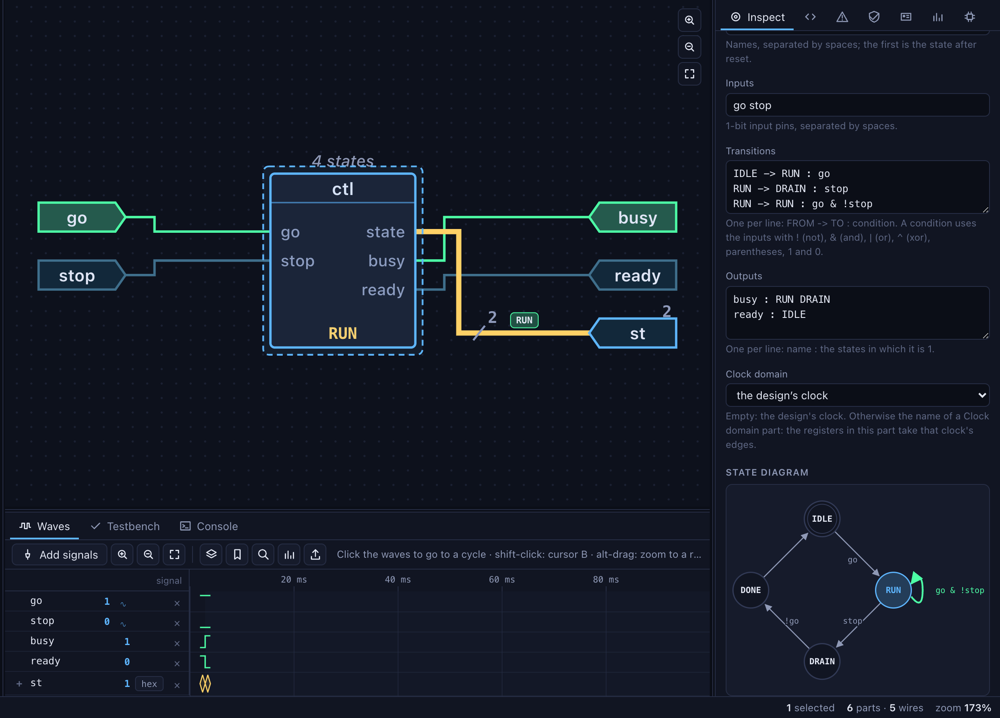

### 2.2 Truth tables
- **Rows:** a Truth table part has named 1-bit inputs and outputs. Each row reads `0 1 - | 1 0`: the inputs' values (0, 1 or `-` for either), a bar, then the outputs. Rows that are not listed give 0.
- **Checking:** rows that can match the same inputs but disagree are a problem ("rows 1 and 2 match the same inputs…").
- **The grid:** the inspector shows every input combination. Click an output to flip it (the rows are then written out in full). With don't-cares the grid is read-only and shows the function the rows give. While the design runs, the row of the current inputs is lit.
- **In the Java:** `TruthTable.parse("""…""").apply(Map.of(…))` from the standard library.

### 2.3 Memories
- **Fields:** a Memory part has a name, a word width, a depth, a read kind, an optional write port and initial words.
  - **async** reads give the data in the same cycle as the address.
  - **sync** reads give it one cycle later, as block RAM does. A sync read is declared with the state, so a loop through it (an address computed from the data, as in a pointer chase) is legal.
- **Ports and checks:**
  - Without a write port the memory is a ROM of its initial words.
  - The address must be at most ⌈log2 depth⌉ bits; a wider one is a problem with a fix (use the low bits).
- **In the Java:** `Mem<UInt> m = mem("m", UInt.w(8), 16).init(…)`, with `m.read(addr)` or `m.readSync(addr)` and `m.write(addr, data, we)`.
- **Contents:** select the memory to see its words in the inspector, as a hex grid at the cycle shown. It follows the run, words that changed are lit, and *From* jumps to an address. The grid shows the past as well, as far back as time travel reaches.
- **Writing a word:** double-click it and give a value. The write happens at the latest cycle and is kept in the history like an input, so going back shows the old word and coming forward again replays the write. Studio refuses a write while you look at a past cycle (step or run to come back first).

### 2.4 How drawings look
The design inspector (click the empty canvas) has a **View** section, kept in the browser:
- **Active-low names with a bar:** `rst_n`, `cs_b` and `oe_l` are drawn as their base name with a bar over it; the tooltip gives the name as written. On by default.
- **Activity heat:** wires are tinted by how often their value changed in the last 256 cycles: grey when it did not change, then teal, lime, amber and pink for under 1 %, 5 %, 25 % and more of the cycles. It is computed from the record on the server, three times a second while frames arrive.
- **Gate symbols:** ANSI (distinctive shapes) or IEC 60617 (rectangles marked `&`, `≥1`, `=1` and `1`, with a bubble for an inverted output).

---

## 3. Types and widths

Studio applies Tessera's own rules as you draw, so a drawing that shows no problems also compiles and elaborates.

- **Add and subtract:**
  - *widen* gives one bit more than the wider operand (it never overflows);
  - *wrap* keeps the wider operand's width;
  - widen-subtract sets the top bit when b > a.
- **Multiply** is as wide as both operands together.
- **Bitwise logic** (AND, OR, XOR and their inverses) needs operands of one width; Studio offers to zero-extend the narrower one.
- **Comparisons and reductions** give one bit.
- **Shifts:** a constant left shift grows the value by its amount; right shifts and variable shifts keep the width.
- **A multiplexer** widens its inputs to the widest; with more than two inputs its select needs ⌈log2 n⌉ bits.
- **Assignment** (a wire into a register, an output or a block's port) zero-extends a narrower value. It **never narrows**: a wider value is a problem, with fixes to widen the target or keep the low bits.
- **Conditions** (a register's enable, a mux's two-way select, an assertion) need one bit; fixes offer "any bit set" (orR) or bit 0.
- **Types:** a 1-bit value is a `Bool`, wider ones are `UInt`. Pins show their type in the inspector, with the value now.

**Problems** are listed in the Problems tab (badge in the toolbar), one sentence each, naming the parts. The parts are outlined on the canvas: red for errors, amber for warnings. Clicking a problem selects and centres its parts. A **fix-it** button applies the fix as one undo step. Problems come from three places:
1. Studio's own checks, as you draw (§10.2 lists every one);
2. the Java compiler, mapped back to the parts whose lines it names;
3. Tessera's elaboration (`TesseraException`), with its own fixes where it has them.

**When there are errors** the simulator keeps running the last good design, and the status line says so. Nothing is lost: fix the problem and the design reloads.

---

## 4. Java

### 4.1 What is generated
- **The design:** a drawing is one Java class, `public class Name extends Module`, in the package set in the inspector (click empty canvas to see the design's own fields).
- **The order:** ports, registers, memories, state machines and instances are declared first; then the logic, in order of dependency; then what drives the outputs and registers.
- **Names:** every value is named after its wire's name, or after its part, so the Java reads like hand-written Tessera and every wire has a name in the hardware.
- **Imports:** only what is used.

The **Java** tab shows the code, highlighted. Selecting a part highlights its lines; clicking a line selects its part. Two more views:
- **Last change** shows what the last edit did to the Java: lines added and removed, with three lines of context around each. Moving parts does not count as a change.
- **SystemVerilog** shows the Verilog that Tessera emits for the running design (read-only).

### 4.2 The file format
- **The trailer:** a saved `.java` file ends with one comment line, `// tessera-studio:1 …`, holding the drawing, compressed (deflate, then base64url). The rest of the file is ordinary Tessera Java.
- **Opening:** opening the file in Studio (⌘O) restores the drawing exactly when the Java is as Studio wrote it. To the compiler, the trailer is only a comment.
- **Edited and hand-written files:** if the Java was edited outside Studio, or has no trailer, Studio reads the Java instead (§4.5); the trailer, if there is one, keeps the places of the parts still there. To watch a design without drawing it, open it through `--designs` or *Designs* (§5.7).
- **JSON export:** *Export → The drawing as JSON* gives the drawing itself (parts, wires, blocks, notes). It is the same document the HTTP API takes (§10.5).

### 4.3 Java code parts: the boundary of the drawing
Some things are clearer in Java than in a drawing: loops, generators, a parameterised structure, anything that uses the whole language. A **Java code** part (palette: *Modules → Java code*) is a module written by hand inside the drawing.

- **Placing one** opens its class in the Java tab's **Part code** view. It is a `public static class X extends Module` with its ports in public fields.
- **Applying:** ⌘Enter applies the class. Studio compiles it and elaborates it to find its pins (each public field that holds a port becomes a pin), and the part takes those pins. A compile error is shown with its line number inside the class.
- **Imports:** the class may use Tessera's core and standard library, and `List` and `Map`, without importing them.
- **In the file:** it is nested in the generated file, as blocks are.

### 4.5 Editing the Java
The Java tab's **Edit** button turns the generated Java into an editor; ⌘Enter (or *Apply to the drawing*) reads it back, as one undo step.
- **The dialect:** the statements the Studio writes (ports, registers, memories, state machines, tables, library calls, gates and operators, instances, `withClock`) become their parts again with their wires. Parts that are still there keep their places and ids; new ones are laid out below the drawing.
- **Anything else:** Java outside that style (a loop, a nested `when` with blocks, a helper) is not guessed at. Each run of such statements becomes a **Java code part** holding them verbatim. Its inputs are the values the statements read, and its outputs are the values read after them. A register or output those statements set comes into the code part with them. The console lists each one ("lines 12–14 became the Java code part Code1 (it reads x) (it gives p)").
- **Hand-written files** open the same way (⌘O): the examples' Counter opens as parts; the examples' UartTx opens as a few parts and one code part, and sends the same bits as the original.
- **Not drawable:** a class whose constructor takes parameters (other than the clock) is refused with a sentence; place it as a module part instead (§4.4).

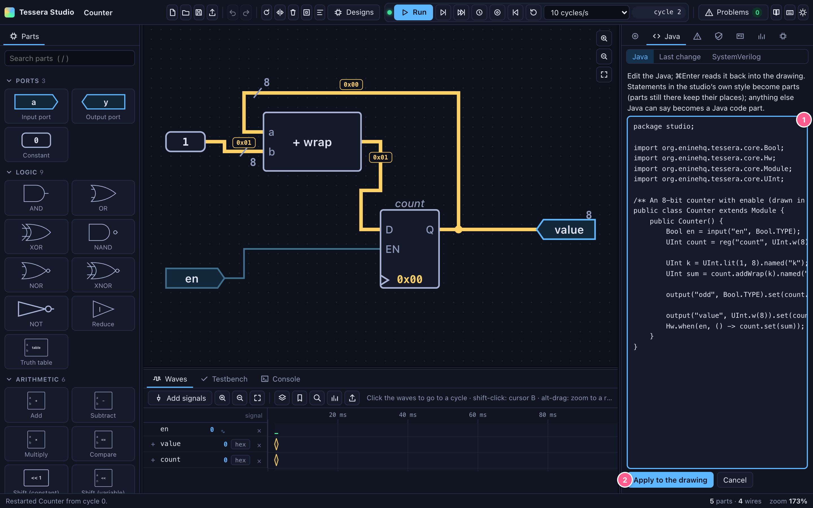

In the picture: **1** the Java being edited (a new output added); **2** *Apply to the drawing*.

### 4.4 Modules from Java
- **Where they come from:** *Modules* in the palette lists the standard library's modules and your project's (`--src`).
- **The expression:** a module part is a Java expression that makes the module, such as `new Fifo<>(UInt.w(8), 16)` or `new Counter(8)`. Edit it in the inspector; Studio elaborates it to find its pins.
- **Pins:** each port reaches its pin through the public field that holds it, including inside records and lists (`u.in.valid()`, `u.read.get(1).data()`). A module whose ports are not in public fields is refused with a sentence.
- **Streams:**
  - A module placed from the palette shows each stream (pins `X_valid`, `X_ready`, `X_bits`) as one stream pin `X ⟩`. A FIFO has three pins (in, out, count) rather than seven.
  - A wire from an output stream to an input stream joins all three: valid and bits go forward, and ready comes back. One sender and one receiver per wire, and the receiver's bits must be wide enough.
  - The wire's tag shows the bits and ✓ in a cycle that transfers, ⏸ when the receiver is not ready (the wire turns amber), and — when nothing is valid.
  - To wire a stream bit by bit, for example from ports, untick *X as one stream pin* in the inspector. Drawings made before streams existed keep separate pins.
- **Arguments:** project modules are listed with their first public constructor, and a default for each argument (8 for numbers, false for booleans, `clk` for a `Clock`). Change the arguments in the inspector.

---

## 5. Simulating

The design starts running when it first elaborates without errors, and it never stops for an edit.

### 5.1 Running
- **Run or pause:** Enter, or the run button.
- **Stepping:** `.` steps one cycle; Shift+`.` steps ten.
- **Rate:** the rate menu sets cycles per second, from 1 to unbounded. The cycle pill shows where you are.
- **Run until** (U, or the target button): runs until a **condition over signals** holds, then stops and marks the waves.
  - Example: `count == 0x2a`, `valid && !ready`, `core.pc >= 0x80`.
  - Operators, loosest first: `|| && | ^ & == != < <= > >= + −`, then `!` and `~`, with parentheses. Numbers are decimal, `0x…` or `0b…`.
  - Studio refuses a condition that already holds, or that names a signal the design does not have.
- **No page watching:** a run pauses when no page has been watching it for 5 seconds. Press Run to go on.
- **Reset** (⌘R) asserts reset for two cycles. The timeline goes on; the waves mark where. A design with no registers has no reset; Studio says so.
- **Restart** (⇧⌘R, or ⌘K) starts a new simulation of the same design from cycle 0. The record and the marks start again, and inputs go back to 0.
- **Assertions** are checked every cycle. A failing `assert` pauses the run, draws a red line through the waves, lists the sentence in the Prove tab and the console, and outlines the assertion part.

### 5.2 Inputs
- **On the canvas:** click a 1-bit input port to toggle it. For a wider input, right-click → *Set the value…* takes decimal, `0x…` or `0b…`, range-checked.
- **On the board:** the Board tab drives any input (§9.3), and board parts on the drawing do too.
- **Stimulus lanes:** the ∿ button on an input's row in the waves gives it a pattern over the coming cycles, like a pattern generator.
  - A pattern is a list of values, each held for N cycles, repeated K times, from a cycle on.
  - Scheduled values are drawn dashed beyond the live head and are applied as the run reaches them. They are logged like any other input, so time travel replays them.
  - A new pattern for the same input replaces the old one; *Restart* clears them all.

### 5.3 What you see
- **Wires:** a 0 bit is quiet and a 1 is bright. A bus carries a tag with its value, in the global radix, or by name for a state machine's state. A wire that just changed flashes.
- **Registers:**
  - a register shows its value inside the symbol;
  - while the next value (D) differs, it is shown greyed beneath (not while its enable is 0);
  - on the clock edge, the new value arrives with a brief flash.
- **Streams:** wires of a module's `X_valid` / `X_ready` / `X_bits` pins turn **amber and dashed** while valid is 1 and ready is 0 (backpressure). They show a **moving dash** while valid and ready are both 1 (a transfer every cycle).
- **FIFOs** show how full they are as a bar.
- **State machines** show their state by name (§2.1).

### 5.4 Several clocks
- **Clock domain parts:** a *Clock domain* part (palette: State) declares a clock of its own: a name and a period in ticks, with the tick of its first edge. A domain part named `clock` sets the period of the design's own clock (every tick otherwise).
- **Parts in a domain:** every part with registers (register, memory, state machine, counter, delay, edge, debounce, LFSR, synchroniser, block, module, code) has a *Clock domain* setting. A part in a domain of its own says so above it ("fcount ⏱ fast").
- **In the Java:** `ClockDomain fast = clockDomain("fast")`, and the part's registers are made inside `withClock(fast, () -> …)`.
- **Crossings:** a value crossing between domains must go through a **Synchroniser** (`Hw.synchronize`, two stages by default) in the receiving domain. Otherwise Tessera's clock-domain check stops elaboration and says where.
- **Running:** a cycle of the run is one tick. At each tick only the clocks with an edge then take one, and time travel replays the same edges. The clock button in the toolbar steps to just after the next edge of a chosen clock.
- **Limits:** domains belong to the top of the drawing (inside a block, set the block's instance's domain instead). Blink and Every count time on the design's clock, so they cannot be in another domain.

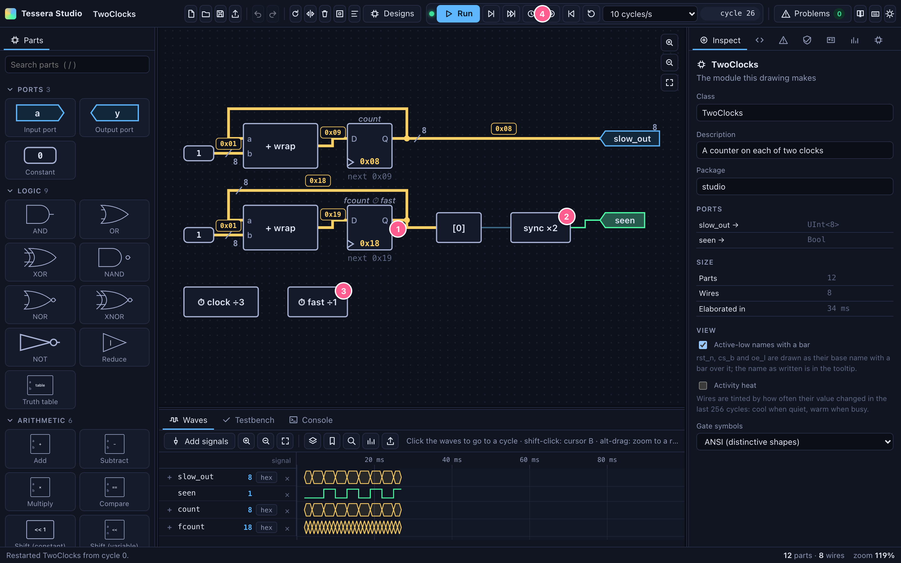

In the picture: **1** a register in the domain fast; **2** a synchroniser where its bit crosses to the design's clock; **3** the domain part (a period of 1 tick, against 3 for `clock`); **4** the button that steps to a clock's next edge.

### 5.5 Testbenches
The dock's **Testbench** tab runs a JUnit-style class against the live run:
- **A test** is a method marked `@Test` (JUnit's annotation) that takes a `Simulator`. JUnit's assertions work as usual.
- **Running** (⌘Enter, or *Run the tests*): the tests run in order from the cycle the run is at. What they poke and step goes into the waves and the history, as if done from the toolbar, and design assertions are checked on every step. The waves mark where each test starts and where one fails.
- **Results:** each test with its cycles. A failure shows its message and the line of the testbench, and clicking it shows that part of the waves. A testbench that does not compile shows its errors with their lines.
- **What a testbench may do:** poke and peek by name, step, reset, read memories. Calls that would go around the run's history (restoring a snapshot, poking a `Data` handle) are refused with a sentence. A testbench stops after 5 million cycles.
- **Saved with the drawing:** the source is part of the drawing, so it travels in the `.java` file.
- **New from the ports:** starts a testbench whose class says which design it tests (a `@Design` method that makes it, and `@ExtendWith(HwTestExtension.class)`), so the same source also runs under JUnit.
- **Each test from reset:** before each test the inputs go to 0 and every reset is held for two cycles, in the run's history like any reset. Memories go back to their initial contents (zero beyond them), as a new simulator has them; the words that change are written in the run's history and marked in the waves. A test then starts the way it does under JUnit.
- **Under JUnit (Gradle):** *Save as a JUnit test* gives the class its package and Tessera's JUnit extension.
  - **With a project:** when the Studio was started with a project (`--src …/src/main/java`), it writes the class to the `src/test/java` beside that root, after asking, and never over an existing file without saying so. Otherwise it downloads the file.
  - **How JUnit runs it:** the extension gives each `@Test` method a new simulator of the design, with every reset held for two cycles. Tests do not see each other's cycles, and they run in JUnit's order, not the source's.
  - **Which design:** a class names its design with a `@Design` method, or with `@TestsDesign(Counter.class)` for a design with a constructor without arguments.
  - **The design must be in the project:** the drawing itself must be saved as `.java` into the project for the test to compile, and the Studio says so when it is missing.

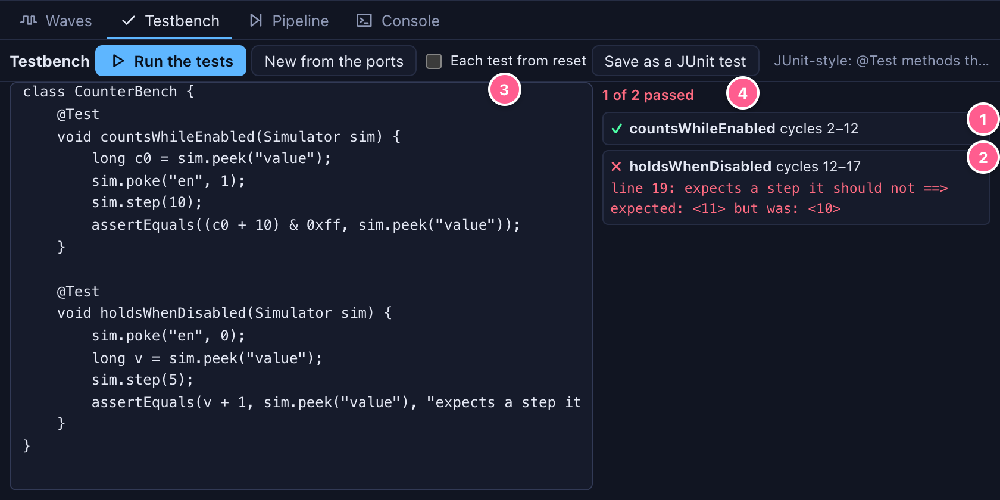

In the picture: **1** a test that passed, with its cycles; **2** one that failed, with its line; **3** *Each test from reset*; **4** *Save as a JUnit test*.

### 5.6 Hot swap
- **Reloading:** every edit that changes the Java reloads the design in place (`HotSwap`). Registers and memories keep their values where their names and widths still match; inputs keep theirs. The waves mark the reload ("reloaded Counter at cycle 402: kept 1 registers, new [x]").
- **Moves:** moving parts does not reload anything. An unchanged design is not rebuilt.

### 5.7 Designs written in Java
- **Opening:** *Designs* opens a design from `--designs` or `tessera-riscv`. It is drawn from its elaborated hardware: registers, ports, memories, instances, and one box per expression that drives a named signal. It is read-only (change the Java to change it) and runs exactly like a drawing.
- **The explorer:** a design of more than 120 parts opens in the explorer, because a complete schematic of a processor is not readable.
  - The left panel lists its signals.
  - Pick one to draw it with the logic that drives it and the signals that logic reads.
  - Then double-click a part to **trace its driver**, or right-click → *Trace the loads*, one step at a time.

- **Programs:** a core opens running its benchmark loop, or a riscv-test chosen from the list. The list appears when the Studio runs inside the repository, where the tests are.
  - A riscv-test passes when `gp` (x3) becomes 1 and the core halts.
  - Run until `core_halted == 1`, then select the register file `regs` to see x3 in its hex grid.

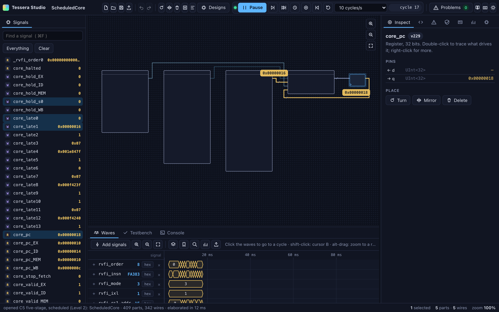

### 5.8 The pipeline diagram
The dock's **Pipeline** tab draws a running pipeline as Konata does: one row per instruction, one column per cycle, and in each cell the stage the instruction was in.
- **Which designs:** any design built with Tessera's `Pipeline` (C2–C6, and pipelines of your own). It reads signals every pipeline already has: a hold wire and a valid bit per stage, and the program counter's copy in each stage. Nothing has to be added to the design. The out-of-order cores (C7, C11 and its variants, and the generated C7g cores) are drawn as their reorder buffer instead: one row per instruction from dispatch to commit, with its state in each cycle (in a reservation station, issued, in the load or store queue, done, committed or flushed) and rows below for the ROB, reservation stations, queues and checkpoints in use.
- **Colours:** a stage in which the instruction **waits** (a stall: load-use, the divider) is amber. An instruction **flushed** by a redirect (a taken branch, a jump, a trap) or a halt is struck through in red, in the cycle it was cancelled. Green marks the cycle an instruction **left the last stage**.
- **Rows:** each row shows the instruction's pc and its assembly, read from the core's instruction memory (`imem`).
- **Time travel:** it shows the cycles up to the one you are looking at, as many as fit. Click a cycle number to go there; the whole tool follows (§7). *Earlier* and *Later* move the window; *Follow* goes back to following the current cycle.
- **What the generator inferred:** for a Level-2 core (C3–C6), the box above the diagram lists the pipeline generator's own report: where redirects resolve, where registers are read and written, and from which stage each result is forwarded and when it stalls. The Analyse pane shows the same list (§9.1).
- **How instructions are followed:** a stage that is not held passes its instructions to the next stage, and a held one keeps them. Valid slots take the oldest instructions expected there, so those left over were flushed. With several issue lanes, a stage's lanes are named `…_l1` and so on, and a pipeline may name an id per stage (`P_id_<stage>`) so that instructions are matched exactly.

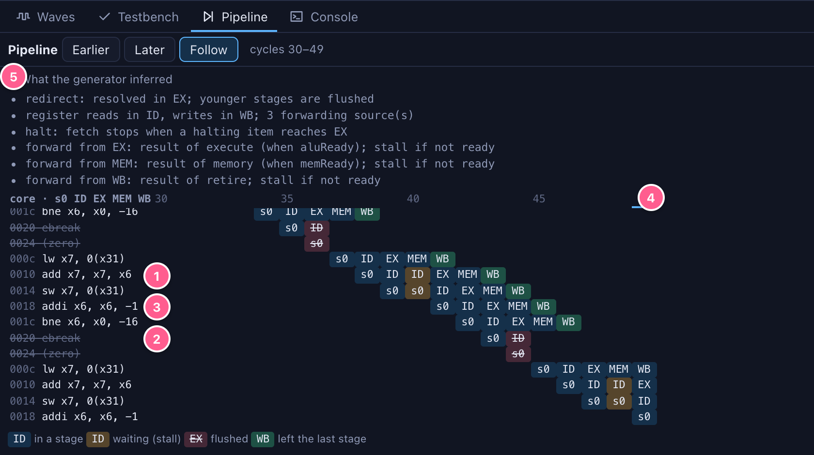

In the picture: **1** an `add` that waits a cycle in ID for the load before it (amber); **2** an instruction fetched after the loop's taken branch, flushed when the branch resolves in EX; **3** an instruction that goes straight through the five stages; **4** the cycle being shown (click any cycle number to go there); **5** the generator's report for this schedule.

---

## 6. Waves

The dock under the canvas shows the waves of chosen signals, recorded from the moment they were added.

- **Adding signals:** select a wire and press W, drag from the middle of a wire and let go over the dock, or use **Add signals**. Add signals is a searchable list of every signal, grouped by instance. Words in the search must all appear in the path (`core pc_ex`). Enter adds the first match, a click adds one, and the list stays open so you can add more.
- **Rows:**
  - Drag a name to reorder. Click to select; shift-click or ⌘-click to select several. Delete removes.
  - Each bus row has a radix button: hex, dec, bin or ± (signed). A state machine's register shows state names.
  - **X** (or the `+` beside a bus) expands a bus into its bits; again folds them.
  - **G** groups the selected rows under a name. Click a group to fold it; double-click to rename it.
- **Time:**
  - Ctrl+wheel (or the zoom buttons) zooms at the pointer; a sideways wheel or a drag pans.
  - **Alt-drag** zooms to the range you sweep. *Fit* shows the whole run.
  - With a frequency (`--hz`), the axis shows time as well as cycles.
- **Drawing large runs:** the waves are drawn from windows of the server's record. When a window holds more changes than there are pixels, each pixel column is drawn as one summary. A million-cycle run draws in about 40 ms, and a zoomed window in under 15 ms.
- **Cursors:**
  - **Click** places cursor A, snapping to a change within 6 px. **Moving A moves the whole tool to that cycle** (§7).
  - **Shift-click** places cursor B. The info line shows A, B and Δ in cycles (and time); a name's tooltip shows the values at A and B.
- **Stepping and searching:**
  - **← / →** go to the previous or next change of the selected signal (or of one bit of it).
  - **⌘F** finds the next time a **condition** holds (the same conditions as *Run until*); F3 repeats; Shift goes backwards. It searches what has been recorded.
- **Markers:** **M** drops a named marker at A.
- **Notes strip:** markers and events are listed as sentences under the waves: reloads, resets, forks, counterexamples, run-until stops and failed assertions. Click one to go there; right-click a marker to delete it. Hover a mark in the waves to read it.
- **Measure** (the chart button): select a signal and place both cursors.
  - For a bit it reports the transitions and rising edges between A and B, the period (in cycles, and in time and Hz with a frequency), and how much of the time it was high.
  - For a bus it reports the changes, the distinct values, and the values it held most of the time.
- **Streams as transactions:** *Add signals* lists every stream (an `X_valid`, `X_ready`, `X_bits` triple) first, as `X ⇄`. A stream row draws a box for each transfer (valid and ready) with its bits, an amber band where the sender waits (valid without ready), and a thin line where the receiver waits for data. Its value column counts transfers ⇄ and stalled cycles ⏸ in view. Over 20,000 cycles it asks you to zoom in.
- **Export** (the dock's export button):
  - a VCD or an FST (GTKWave's compressed format, also read by Surfer) of the shown signals, on the clock's real time: a cycle is 1/hz, in the coarsest unit that holds it exactly (1 kHz gives 1 ms a cycle);
  - an SVG (vector) or a PNG of the window as drawn, with its names;
  - a CSV of the shown signals at every cycle that changed between the cursors (the whole run without them).

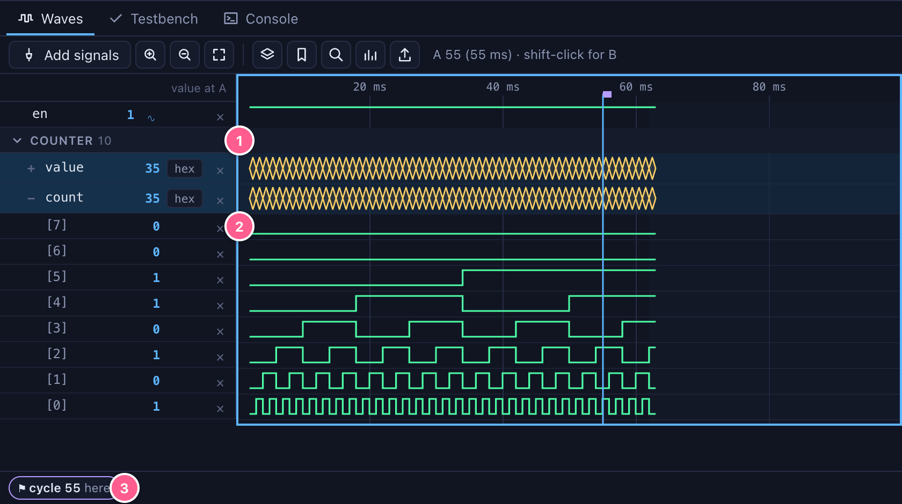

In the picture: **1** a group, folded with a click; **2** a bus expanded into its bits; **3** the marker in the notes strip.

---

## 7. Time travel

- **How it works:** the simulator keeps a snapshot every 256 cycles and the inputs of every cycle (`TimeTravel`). Going to cycle *c* restores the nearest snapshot before it and replays the inputs. Any cycle since the design was loaded is shown exactly, and quickly.
- **Going back:** click the waves, press Backspace (one cycle back), or press Shift+Backspace (to cycle 0).
  - The canvas, the inspector, the board and the waves all show that cycle. The live dot turns amber, and the cycle pill's tooltip says you are looking at the past.
  - Run or step to return to the latest cycle.
  - Cycles before the last reload are shown from the wave record (only the recorded signals, then).
- **Forking:** changing an input while looking at the past **forks** a new future from that cycle. The later record is dropped, and the waves mark the fork.
- **Memory:** long runs are bounded, so a run of hundreds of millions of cycles does not exhaust the server.
  - The simulator keeps at most 4,096 snapshots, about the last million cycles at one snapshot per 256 cycles. Older cycles are shown from the wave record.
  - The record keeps at most 16 million changes in all. When it is full, the oldest half is dropped, and the waves mark where the record now starts. Going to a dropped cycle is refused with a sentence that says where the record begins.
  - Both limits can be changed with `-Dstudio.maxSnapshots=…` and `-Dstudio.waveBudget=…` (in `JAVA_OPTS`).

---

## 8. Proving

**Assert**, **Assume** and **Cover** parts take a 1-bit condition (in Java: `Hw.assertThat`, `Hw.assume`, `Hw.cover`). The Prove tab lists them and runs Tessera's model checker (`tessera-formal`). It uses an SMT solver, z3, bitwuzla or yices: the first one found on the PATH.

- **Bounded** (depth N): no assertion fails within N cycles of reset. A failure gives the **shortest** counterexample.
- **Induction** (k = N): every assertion holds in every cycle, by k-induction.
  - The result is PROVEN.
  - UNKNOWN means the step case failed at this k. Raise k, or add assertions that rule out unreachable states.
- **Cover:** the first cycle at which each cover point can be 1, or "not reached within N".
- **Assumptions** restrict the inputs the checker considers.

A **counterexample** replaces the run:
- the waves show it, marked "counterexample";
- the canvas and the waves can step back through it;
- *Go to the failing cycle* puts everything at the failure.

*Back to the live run* starts the design again from reset.

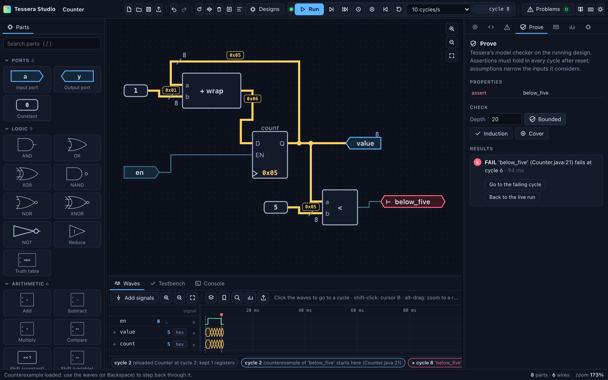

---

## 9. Analysis, the board and building

### 9.1 Logic levels
Tessera's simulator works in cycles; there are no gate delays, so there are no glitches or setup times to display, and Studio does not fake them. The **Analyse** tab shows what can be known before a build. *Logic levels* lists, for each module:
- the longest combinational paths, as levels of logic;
- each from a register, an input or a child module's output, to a register or an output;
- through the named signals on the way.

One operator (an add, a compare, a mux, a gate) is a level. Slices, concatenations, extensions and constant shifts are wiring. Click a path to select its wires on the canvas (in the explorer, it is shown).

For a Level-2 core (C3–C6), *Logic levels* also lists the **pipeline schedule**: what the pipeline generator inferred from the model and the schedule. It covers where redirects resolve and the halt takes effect, where registers are read and written, and, for each later stage, which result is forwarded and when a dependent instruction stalls instead. The Pipeline tab shows it at work (§5.8).

### 9.2 Resources
- **The estimate:** *Estimate resources* runs `yosys synth_xilinx -flatten` on the emitted SystemVerilog. It needs Yosys on the PATH and takes seconds for a core. The result is LUTs, flip-flops, block RAMs, DSPs, LUT RAM and carry chains.
- **What it is not:** this is Yosys's estimate. Vivado usually maps the same design to fewer LUTs; a build gives the real figures.

### 9.3 The board
- **Names that become controls:** the **Board** tab is a front panel for the design's ports.
  - Outputs named `led…` light LEDs.
  - `seg…` (7 bits, a to g) and `hex…` (4 bits a digit) drive seven-segment displays.
  - Inputs named `sw…` are switches; `btn…` are push buttons, 1 while held (Space and Enter work too).
- **Every other port** is listed too: 1-bit inputs as toggles, wider ones as a value field (range-checked), outputs with their values.

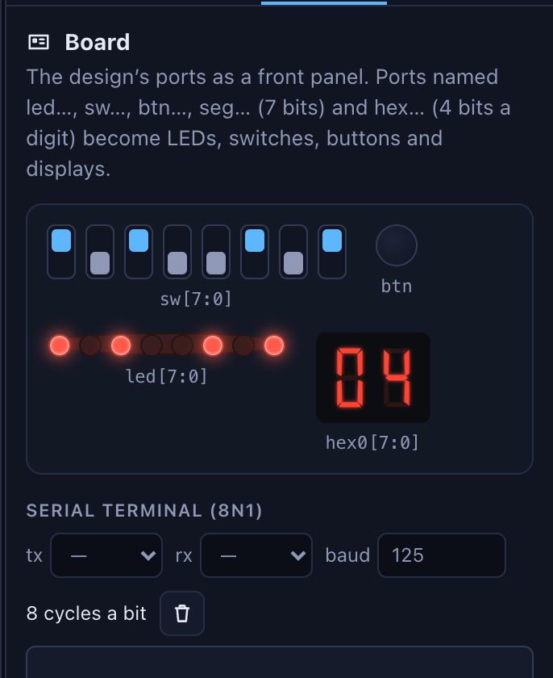

- **Board parts on the drawing:** an input or output port can be **drawn as** board parts (inspector: *Drawn as*). Inputs can be switches (click one to flip its bit) or push buttons (a bit is 1 while held); outputs can be LEDs or hexadecimal digits. Bit 0 is on the right, as on a board. They follow the port's own value, wired or not, and the Java is the same port.

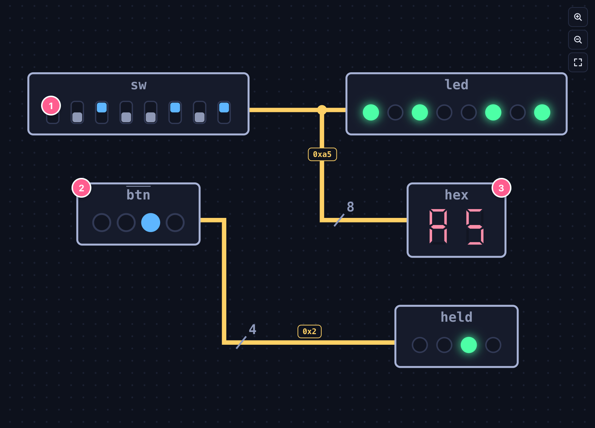

In the picture: **1** switches (bit 7 on the left); **2** push buttons on an active-low input; **3** hex digits showing the switches.

- **Serial terminal (8N1):** pick a 1-bit output as tx and a 1-bit input as rx (`tx…` and `rx…` by default) and a baud. The pane shows how many cycles a bit lasts (hz/baud, at least 2).
  - **Receiving:** what tx sends is decoded cycle by cycle from its recorded wave (a frame with a bad stop bit shows as ⍰).
  - **Sending:** typed text (Enter adds a newline) goes out on rx as scheduled values, after anything still being sent. rx is held at its idle level, 1.
  - It runs on the simulation: run or step to see and send.

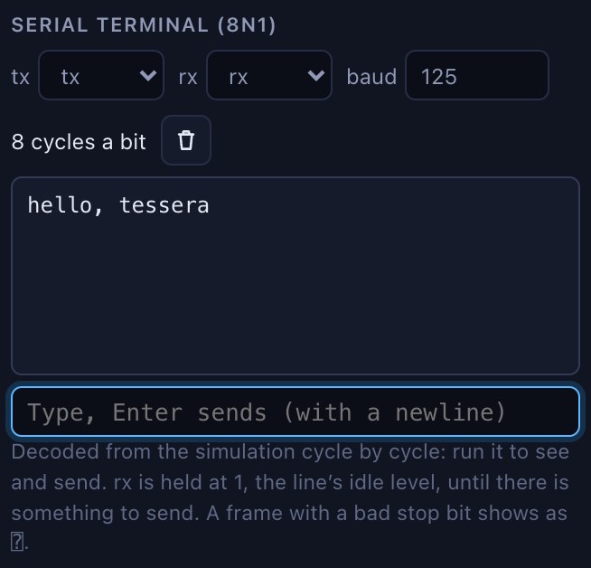

### 9.4 Building for an FPGA
The **FPGA** tab puts a drawing on the ZedBoard's programmable logic.
- **Check the ports** shows where each port goes: outputs named `led…` on LD0–LD7, inputs named `sw…` on SW0–SW7, and `btn…` on the push buttons (BTNC, BTNU, BTNL, BTNR, BTND, in that order). Inputs with other names are tied to 0 and other outputs are left off the board, each with a warning.
- **Build** elaborates the drawing again for the board's 100 MHz clock, so that Blink and Every keep real time. It wraps the design in a top level with a power-on reset and runs Vivado 2020.1 (in Docker) on the host the board is attached to (`ZED_HOST`, default `user@zed-host`). The pane shows LUTs, flip-flops and the worst slack at 100 MHz.
- **Build and program** then programs the board over JTAG with xsct and reports when the FPGA is configured.
- **Pins:** the LED pins are the ones the repository's board tests use (bank 33, 3.3 V). The switch and button pins, and their 1.8 V standard, are the ZedBoard master constraints' defaults; they are inputs only.
- **Not supported:** designs written in Java build with the project's Gradle tasks or `scripts/zed.sh`, as before. They can still be timed (§9.5).

### 9.5 Timing paths
After a build, the **Analyse** tab shows Vivado's worst setup paths, on the drawing and in the Java.
- **Where they come from:**
  - **A board build** (§9.4): its worst 20 paths arrive when it finishes.
  - **Time it with Vivado**, at a clock period you give (in ns): the design out of context (every port kept, the clock on the `clock` port) on the same build host. It works for drawings and for designs opened from Java, such as the cores. It takes about a minute for a small design.
  - **Open a report…**: a Vivado `report_timing -path_type full` of the same design, such as the `paths.rpt` that `scripts/qor_paths.sh` writes. Names are matched, so the report must come from this design. A core opened in the Studio has the same names as the one the script builds.
- **The list:** each path's slack, delay, logic levels and share of routing, and where it starts and ends. A path no clock constrains (from an input port, out of context) says so instead of a slack.
- **A path's steps:** the hops Vivado lists (a cell's arc, then a wire), grouped by the signal of the design they belong to. Each step shows:
  - its delay, its cells (DSP48E1, CARRY4×3, …) and its routing;
  - for an operation's wire, the operation, its name and the signal it feeds (`add _t1007 → p_WB_4`);
  - its Java line, with the code of that line when the file is found.

  Clicking a step opens its line in the Java tab (for a drawing) or names it.
- **On the canvas:** the path's wires are selected, and each part on it gets a number in path order with its delay. A part that several steps pass through lists them ("steps 2, 4, 6: 2.70 ns"). For a design in the explorer, the path's signals are drawn with what drives them.
- **How sure the mapping is:** each hop is
  - **exact**: the cell or wire is a signal of the design, a bit of it, its register, or a copy Vivado made of it;
  - **≈ approximate**: a LUT or carry cell Vivado named after a signal that its logic only helps compute;
  - **unmapped**: a name synthesis made up.

  The badges give the share of each over the listed paths. On the 50 worst paths of each validation core, fewer than 4% of hops are unmapped.
- **Beside it:** after *Logic levels*, a path also shows the IR's estimate (levels of operators) for the same end register.
- **Not shown:** openXC7's timing. nextpnr-xilinx does not model DSP and memory cells, so its paths are not trusted for these designs, and a report that is not Vivado's is refused with that reason.

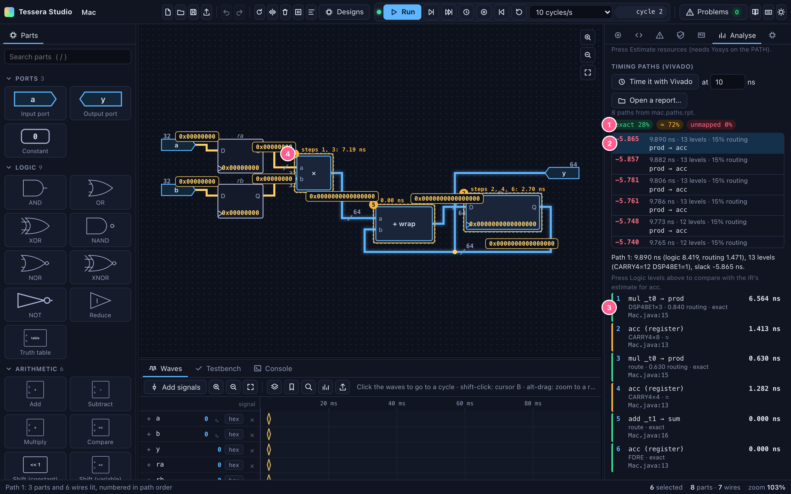

In the picture:
- **1** how the hops map;
- **2** the worst path, chosen;
- **3** its steps, with their delays and Java lines;
- **4** the parts on the canvas, numbered in path order with their delays.

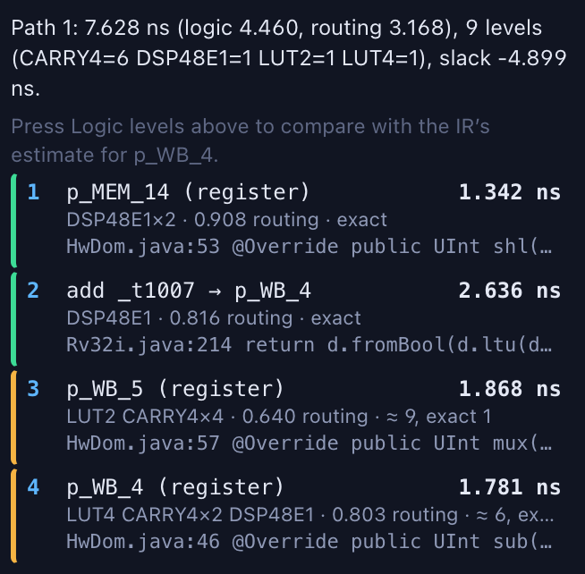

C5's worst path, from the report of its out-of-context run, opened on the core in the explorer: from a DSP register in MEM (`p_MEM_14`) through the carry of the multiply's sum (`Rv32i.java:214`) into a DSP that Vivado uses in write-back (`p_WB_4`). Since the multiply is summed in MEM and corrected in WB, this 9-level path is short (slack −4.899 ns at 5 ns, about 101 MHz).

---

## 10. Reference

### 10.1 Parts

| Part | Parameters | Generates |
|---|---|---|
| Input port | name, width, drawn as (port, switches, buttons) | `input(name, UInt.w(w))` (`Bool.TYPE` for 1 bit) |
| Output port | name, width, drawn as (port, LEDs, hex) | `output(name, …).set(v)`; a narrower value is zero-extended |
| Constant | value (dec, 0x, 0b), width (0 = just enough) | `UInt.lit(v, w)` |
| AND OR XOR NAND NOR XNOR | inputs (2–16) | `a.and(b)` …; equal widths; the N- forms add `.not()` |
| NOT | — | `a.not()` |
| Reduce | op: or, and, xor | `a.orR()` `a.andR()` `a.xorR()` |
| Add | mode: widen, wrap | `a.add(b)` / `a.addWrap(b)` |
| Subtract | mode: widen, wrap | `a.sub(b)` / `a.subWrap(b)` |
| Multiply | — | `a.mul(b)` |
| Compare | op: eq ne lt le gt ge | `a.eq(b)` … (unsigned) |
| Shift (constant) | dir, amount | `a.shl(n)` / `a.shr(n)` |
| Shift (variable) | dir | `a.dshl(n)` / `a.dshr(n)` |
| Multiplexer | inputs (2–64) | `Hw.mux(sel, in1, in0)`, or `Hw.index(sel, List.of(…))` |
| Slice | hi, lo | `a.bits(hi, lo)`, or `a.bit(i)` |
| Concatenate | inputs | `Hw.cat(top, …)` |
| Resize | width | `a.zext(w)` / `a.trunc(w)` |
| Register | name, width, reset value, enable, clock domain | `reg(name, type, init)`, `r.set(d)` or `Hw.when(en, …)` |
| Memory | name, width, depth, read (async, sync), write port, initial words | `mem(…).init(…)`, `read` / `readSync`, `write(addr, data, we)` |
| State machine | name, states, inputs, transitions, outputs | nested `enum`, `HwEnum` register, `Hw.when` chain |
| Truth table | inputs, outputs, rows | `TruthTable.parse(…).apply(…)` |
| Blink, Every | seconds | `Timing.blink(clk, …)`, `Timing.every(clk, …)` |
| Counter | max | `Util.counter(max, inc)` → value, wrap |
| Edge detector | rising, falling | `Util.risingEdge(a)` / `fallingEdge` |
| Delay | cycles | `Util.delay(a, n)` |
| Debounce | cycles | `Util.debounce(a, n)` |
| LFSR | width (2–32) | `Util.lfsr(w, step)` |
| Bit utility | popCount, reverse, toGray, fromGray | `Util.popCount(a)` … |
| One-hot | n | `Util.oneHot(idx, n)` |
| Priority encoder | — | `Util.priorityEncoder(a)` → index, valid |
| Clock domain | name, period (ticks), first edge | `ClockDomain x = clockDomain("x")`; parts in it are made in `withClock(x, …)` |
| Synchroniser | stages (2–8) | `Hw.synchronize(a, n)` in its part's domain |
| Assert, Assume, Cover | name | `Hw.assertThat(c, name)`, `Hw.assume`, `Hw.cover` |
| Block | (its definition) | nested class, `instance(name, () -> new Block())` |
| Module | Java expression, imports, instance name | `var u = instance(name, () -> expr)` |
| Java code | the class | the class, nested; then as Module |

### 10.2 Problems

Each problem names its parts. Fixes are offered where one is unambiguous.

| Code | Says | Fixes |
|---|---|---|
| open-input | an input pin is not connected | tie it to 0 |
| no-driver | a wire reaches inputs but nothing drives it | — |
| two-drivers | a wire has two outputs on it | — |
| pin-two-nets | a pin is on two wires | — |
| no-pin | a wire goes to a pin the part no longer has | remove the wire |
| width-mismatch | bitwise operands of different widths | zero-extend the narrower |
| narrowing | a wider value into a narrower register, port, memory or pin | widen the target; keep the low bits |
| not-one-bit | a condition or select needs one bit | any bit set (orR); bit 0 |
| sel-narrow (warning) | a select too narrow to reach every input | — |
| comb-loop | a loop with no register in it | — |
| bad-slice | bits outside the value | take the top bit instead |
| const-too-wide, init-too-wide, init-too-long | a value does not fit its width or depth | widen, deepen |
| bad-number, bad-width, bad-name, name-clash | a field is not a number, a width, a Java name, or a name is used twice | — |
| fsm, table | the text of a state machine or truth table is wrong (a sentence says where) | — |
| stream | a stream wire with two senders, no receiver, or a plain pin on it | — |
| no-block, block-loop | a block that does not exist, or contains itself | — |
| no-module, no-code | a module or code part without pins | — |
| unused (warning) | logic that reaches no output or register (it is optimised away) | — |
| javac | the Java compiler, with the line | — |
| tessera | Tessera's elaboration, with its own fixes | as Tessera gives |

### 10.3 Shortcuts

Keys are ignored while you type in a field. **?** shows them in the tool, and there you can **change** them: click an action's keys, then press new ones. A chord another action had moves to the new one (it is said which); ↺ restores one action and *Back to the defaults* all of them. Tooltips, menus and the command palette show the keys as you have set them. The tables below are the defaults. The keys that depend on the selection (keyboard wiring, Delete, Esc, the arrows) are fixed.

| Edit | |
|---|---|
| ⌘Z, ⇧⌘Z or ⌘Y | undo, redo |
| ⌘C ⌘X ⌘V ⌘D ⌘A | copy, cut, paste, duplicate, select all |
| Delete | delete the selection |
| R, ⇧R, M | turn, turn back, mirror |
| B | make a block of the selection |
| L | name the selected wire |
| / | add a part (search) |
| ↑↓←→ (⇧) | nudge by 1 (10) |
| Alt-drag a wire | add a bend; Alt-click a bend removes it |
| Tab, ⇧Tab, arrows, Enter, Esc | keyboard wiring (§2) |

| View | |
|---|---|
| F, ⇧F | fit the drawing, fit the selection |
| + − or Ctrl+wheel | zoom |
| Space-drag or middle-drag | pan |
| Double-click a block; Esc | open it; go back up |
| \ | hide the panels |
| T | light or dark |
| ⌘K | every command |

| Simulate | |
|---|---|
| Enter | run or pause |
| . , ⇧. | one cycle, ten cycles |
| U | run until a condition |
| Backspace, ⇧Backspace | one cycle back, to cycle 0 |
| ⌘R, ⇧⌘R | reset, restart from cycle 0 |
| the clock button | to the next edge of a clock (designs with several clocks) |
| W | add the selected wire to the waves |

| Waves (with the waves focused) | |
|---|---|
| click, ⇧click | cursor A (moves the tool), cursor B |
| ← → | previous or next change of the selected row |
| ⌘F, F3, ⇧F3 | find a condition, next, previous |
| M | marker at A |
| G | group the selected rows |
| X | expand or fold a bus |
| Alt-drag | zoom to a range |
| Delete | remove the selected rows |

| Files | |
|---|---|
| ⌘S | save as `.java` (with the drawing inside) |
| ⌘O | open a `.java` saved by Studio, or a `.json` drawing |

### 10.4 Settings
Studio keeps its settings in the browser:
- the theme;
- panel widths and the dock height;
- the open palette groups;
- the wave rows, groups and markers;
- the last conditions used;
- your shortcuts;
- the View section's choices (overbars, activity heat, gate symbols).

Nothing is sent anywhere but the Studio server on 127.0.0.1.

### 10.5 The HTTP API
- **The surface:** everything the page does goes through a small JSON API on the server, so scripts and other tools can drive Studio too. `POST /api/<name>` takes a JSON body and returns JSON. Errors are `{"error": "sentence"}`, with status 400.
- **Values:** values in frames and waves are hexadecimal strings.

| Endpoint | Body | Answer |
|---|---|---|
| `parts` | — | the part catalogue: types, parameters, pins, help |
| `codegen` | `{doc}` | `{className, java, problems, netWidths, netPaths, lines}` without running anything |
| `elaborate` | `{doc}` | as codegen, then compiles, elaborates and hot-swaps the design into the running simulation; `{elaborated, ports, message}` |
| `open` | `{java}` | `{doc, report}`: an unedited Studio file from its drawing; an edited or hand-written one read from its Java |
| `read` | `{java, doc}` | `{doc, report}`: edited Java read back, keeping the places of `doc`'s parts |
| `events` | (GET) | Server-Sent Events: `frame` (cycle, values by net), `assert`, `until` |
| `sim` | `{cmd: run, pause, step n (or edge: clock), until n or expr, reset, restart, poke path value, memwrite path addr value, schedule path at, goto cycle, rate rate, record paths}` | `{cycle, running, message}` |
| `fst` | `{paths}` | the recorded waves as FST (base64), with the time unit |
| `uart` | `{tx, baud, from}` | the 8N1 bytes tx sent since `from`, and where to go on |
| `activity` | `{paths, span}` | how often each signal changed in the last `span` cycles |
| `transactions` | `{stream, from, to}` | a stream's transfers, stalls and waits as runs |
| `bench` | `{source}` | a testbench compiled and run: each test's result, cycles, message and line |
| `pipeview` | `{from, to}` | the pipeline diagram over those cycles (default: 40 up to the one shown): per pipeline its stages, lanes and instructions (pc, assembly, cells as `[cycle, stage, lane, waiting]`, and how each ended); the generator's schedule report |
| `waves` | `{paths, from, to, columns}`; `{list: true}`; `{find: expr, from, dir}` | windows of the record (exact or one summary per column), marks; signals; the cycle a condition holds |
| `prove` | `{mode: bmc, prove or cover, depth}` | status, sentence, failing check and cycle; the counterexample is loaded |
| `designs`, `view` | `{design}` | the designs that can be opened; one opened, drawn as a document |
| `modules`, `module` | `{expr, imports}` | modules to place; one probed, with its pins and their Java paths |
| `code` | `{cls, source}` | a Java code part's class probed |
| `analyse` | `{yosys}` | logic levels per module, resources, and the pipeline schedule of a Level-2 core |
| `timing` | `{action: map, report, source}`; `{action: run, period, paths}`; `{action: status, job}` | a Vivado report's paths mapped onto the running design; an out-of-context timing job; its state, log and paths |
| `fpga` | `{action: plan, doc}`; `{action: build, doc, program}`; `{action: status, job}` | where the ports go; a build job; its state, log and results |
| `sv` | — | the running design as SystemVerilog |

The document (`doc`) is the drawing as JSON:
- `name`, `title`, `package`;
- `parts` (`id`, `type`, `x`, `y`, `rot`, `mir`, `params`);
- `nets` (`id`, `pins` as `[part, pin]` pairs, optional `name`, `via` bends);
- `blocks` (name → a document of the same shape);
- `notes`.

### 10.6 Limits, said plainly
- **Two-state, cycle-based simulation:** no X, no gate delays, no glitches.
- **Clock domains:** periods are whole numbers of ticks, so clocks whose ratio is not rational are approximated. Designs from Java with several clocks run every clock every tick (their periods are not known).
- **Java round trip:** statements outside the dialect come back as code parts, not as drawn logic (§4.5). A constructor with parameters is not drawable.
- **Testbenches:** on the live run they share one timeline; under JUnit each test has its own simulator. *Each test from reset* makes the two start alike: inputs at 0, memories at their initial contents, resets held (§5.5). Registers without a reset value keep what they hold in the Studio; a new simulator starts them at 0.
- **The pipeline diagram:**
  - It is drawn for designs built with `Pipeline`, not for C7.
  - It shows cycles in the wave record. A pipeline inside a child instance is not found; only the top module's are.
  - The assembly comes from the instruction memory as it is now, so a program that rewrites its own code would be labelled with the new words.
  - Several lanes without an id per stage are matched by age, so a hypothetical reordering inside a stage would be drawn wrongly.
  - The dual-issue cores (C9, C10) are drawn one row per pair, from lane 0's signals. Their lane 1 has no named valid or pc signals in each stage; naming them would change the cores' generated RTL. Their schedule report is shown.
- **Large designs:** a drawing of several hundred parts routes slowly (tens of seconds for a whole processor). Designs over 120 parts therefore open in the explorer.
